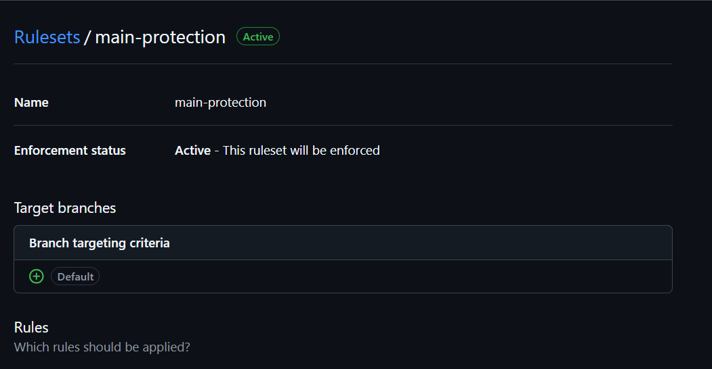

# Milestone 5 - Operations Document

**Team:** Team 01 - SmashGo

**Topic:** D2 - Sports Platform

**Members:**

- Chử Vũ Thảo Hiền (ID: 11247287)
- Phan Thị Anh Quỳnh (ID: 11247347)
- Bùi Phương Thảo (ID: 11247353)

**Product Owner:** @dqchien

**Scrum Master (Sprint 5):** @Buithaoaineu

**Repository:** https://github.com/SE-FDA-NEU-AI66B/software-group1-topicd2

---

## 1. Running and releasing

| Item | Value |
| ---- | ----- |
| Public URL | `<RENDER_URL>` (health check: `<RENDER_URL>/health`) |
| Platform | Render Web Service, free plan, defined in [`render.yaml`](../render.yaml) |
| Runtime | Python 3.12, `gunicorn app:app --bind 0.0.0.0:$PORT`, 1 worker with 4 threads |
| Database | SQLite at `instance/smashgo.sqlite3`, recreated by `init_db.py` at every start |
| Secrets | `SECRET_KEY` is generated by Render; nothing secret is stored in Git |

**Release flow.** Every change goes through a branch and a pull request that another member reviews. When the pull request is merged, GitHub runs `ci.yml` on the new commit on `main`. Render's auto-deploy is set to `checksPass`, so it builds the commit only after every check is green; a red run is never deployed. Render then runs `pip install -r requirements.txt`, starts `python init_db.py && gunicorn ...`, and calls `/health`. The new version replaces the old one only when `/health` returns 200.

**Rollback.** We have two ways back to a working version:

1. **Render rollback (fastest, about 2 minutes).** Dashboard → *smashgo* → *Events*, choose the last good deploy and click *Rollback*. Use it when the site is down and the cause is not clear yet.
2. **`git revert` (keeps `main` honest).** Run `git revert -m 1 <merge-commit>` on a new branch and open a pull request. After review and green CI, Render deploys the reverted code. We always do this after a Render rollback, so the next deploy does not bring the bug back.

## 2. CI pipeline

The pipeline is [`.github/workflows/ci.yml`](../.github/workflows/ci.yml). It runs on every push and on pull requests to `main`. A newer push to the same branch cancels the older run.

| Job / step | What it checks |
| ---------- | -------------- |
| Detect stack | Finds `requirements.txt` (Python) or `package.json` (Node), so only the needed job runs. The Node job is skipped. |
| Python tests → Install | Installs `requirements.txt` plus `pytest`, `pytest-cov` and `ruff` on Python 3.12. Fails if a dependency cannot be installed. |
| Python tests → Lint | `ruff check .` for unused imports, undefined names and style. Warning only for now (see section 4). |
| Python tests → Test | `pytest` with coverage. Uses a temporary database, a frozen clock and a fake bank gateway, so it needs no server, `.env` or real date. Any failed test turns the run red. |
| Python tests → Summary | Writes the number of tests run, failed and skipped to the run page. |
| No secrets committed | Searches every tracked file for AWS keys, GitHub tokens, private keys and hard-coded passwords, and blocks `.env` files and database dumps. |
| Deploy | Not a step in `ci.yml`. Render watches the checks on `main` and deploys only when they are all green (`autoDeployTrigger: checksPass`). |

**Duration.** The last 10 runs on `main` took 40 to 53 seconds, about 45 seconds on average.

**Latest green run on `main`:** https://github.com/SE-FDA-NEU-AI66B/software-group1-topicd2/actions/runs/42464337620 (commit `3738c38`, 8 Nov 2026). Update this link at the wrap-up.

**Branch protection on `main`:** screenshot added with #130.

<!-- Replace this line with the screenshot from #130, for example:
 -->

## 3. Monitoring

**What the app logs.** All logs go to stdout, which Render collects. Each request writes one line:

```text
2026-11-08 15:52:19,074 INFO request method=GET path=/courts status=200 duration_ms=40.9
```

An unhandled error writes an `ERROR` line with the full stack trace, and a failed health check writes `Health check failed: database unavailable` with the SQLite error.

**Where to read them.** Render dashboard → *smashgo* → *Logs*. The search box filters lines, for example `status=5` for server errors or `/health`.

**What is never logged.** Only the path is written, never the query string, form fields, JSON bodies, headers or cookies. Passwords, session tokens, OTPs, bank account numbers and email addresses therefore never reach the log. `tests/test_health.py` checks this for `POST /login`.

**What `/health` checks.** It opens the SQLite file in read-write mode without creating it and reads `sqlite_master`. It returns 200 `{"status":"ok","database":"ok"}` when this works and 503 `{"status":"error","database":"unavailable"}` when the file is missing or is not a database. Render calls it during every deploy and while the service runs.

**Noticing when things get worse.**

| Signal | How we see it | Action |
| ------ | ------------- | ------ |
| Error rate rises | Search the logs for `status=5`; more than a few per hour is not normal | Open the stack trace, roll back if users are blocked |
| Response time rises | Search the logs for `duration_ms=` values above 1000; check the *Metrics* tab for CPU and memory | Find the slow path; restart if memory is near 512 MB |
| App or database down | `/health` returns 503 or does not answer; Render shows the deploy as failed | Read the deploy log, then roll back (section 1) |
| Nobody is watching | Before each demo and each Monday, a member opens `<RENDER_URL>/health` and the logs | See section 5 |

## 4. Risks and technical debt

| Item | Layer | What could happen | Plan |
| ---- | ----- | ----------------- | ---- |
| SQLite is reset on every restart | data | On the free plan the disk is wiped at each deploy or restart, so bookings, linked bank accounts and approved courts made on the URL disappear; only the sample data comes back | accepted: a persistent database costs money and the course demo only needs the sample data plus same-day bookings |
| Free instance sleeps after 15 minutes idle | infrastructure | The first visitor waits 30-60 seconds while the service wakes up, and the restart also resets SQLite | accepted: we open the URL a few minutes before every demo |
| One booking holds one time slot | code | Users cannot book several slots in one booking (M3 feedback #10) | accepted: US-04 is defined as one slot; changing it changes the scope of a P0 story |
| Lint does not block the build | tests | `ruff` runs with `continue-on-error`, so new style errors or unused code can be merged | accepted: `ruff check .` passes today and every pull request is reviewed; we make it blocking after `v1.0` |
| Bank and OTP are simulated | code | `bank_gateway.py` never moves real money; it cannot be used in production as it is | accepted: real payments are outside the course scope |
| Single worker with SQLite | infrastructure | Many users writing at once wait for each other; a long request delays others | accepted: one writer is what SQLite supports; the load of a class demo is small |
| No automatic alerts | infrastructure | A failure is only seen when someone looks at the logs or `/health` | accepted: free alerting tools are not set up; weekly manual check in section 5 |

## 5. Maintenance plan

| Area | What to do | Owner | How often |
| ---- | ---------- | ----- | --------- |
| Bugs | Turn every reported bug into an issue with steps to reproduce; fix with a test that fails first | @dqchien (triage), assignee fixes | Triage every week; P0 bugs the same day |
| Dependency updates | Update `Flask`, `gunicorn`, `python-dotenv` and the test tools within their version ranges; run `pytest` before merging | @Buithaoaineu | Monthly, and at once for a security notice |
| Data backup | The schema (`schema.sql`) and sample data (`init_db.py`) are in Git, so the database can be rebuilt at any time; no user data is kept long enough to back up (section 4) | @quynhquynh-blip | Check that `init_db.py` still builds the database on every pull request that touches the schema |
| Monitoring | Open `/health` and the Render logs, search `status=5` and slow `duration_ms`, record anything unusual as an issue | @quynhquynh-blip | Every Monday and before each demo |
| Documentation | Keep `README.md`, `docs/SETUP.md`, `docs/traceability.md` and this file in step with the code; a pull request that changes a route or a setup step updates them | Author of the pull request; reviewer checks | Every pull request; full read at each sprint wrap-up |

## 6. Lessons learned

**1. Tests that depended on the real date and the demo data.**
*What happened:* At the start of Sprint 4 several tests read the real clock and relied on the seeded demo bookings, so their result depended on the date and on the local database. A clean clone could not run them reliably.
*What we changed:* #109 added shared fixtures: a temporary database for each test, a frozen clock and a fake bank gateway. `pytest` now passes on a clean clone and in CI.
*Next time:* We set up the fixtures before writing the first test, and treat "passes on a clean clone" as part of done from the start.

**2. Several people editing one file at the same time.**
*What happened:* While writing `docs/testing.md`, three members added test cases to the same tables and numbered them in parallel. Several pull requests ran into merge conflicts in the same lines.
*What we changed:* Each story section got its own reserved range of test case IDs, and we merged the testing pull requests one by one, pulling `main` after each merge.
*Next time:* We split shared documents by owner before work starts and agree on ID ranges at planning.

**3. Problems found by others, not by us.**
*What happened:* The M3 review found bugs we had not seen: the court checkbox could not be ticked on a desktop browser, prices used two formats, and the Admin screen showed the raw value `active`.
*What we changed:* The Sprint 5 log lists every feedback item with a priority, and #128 fixes the *Must* items with a before / after screenshot for each.
*Next time:* Before a milestone, each member clicks through every P0 story on the public URL in a desktop and a phone browser, using a checklist, before we submit.
