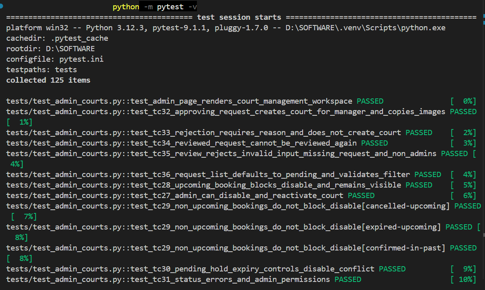
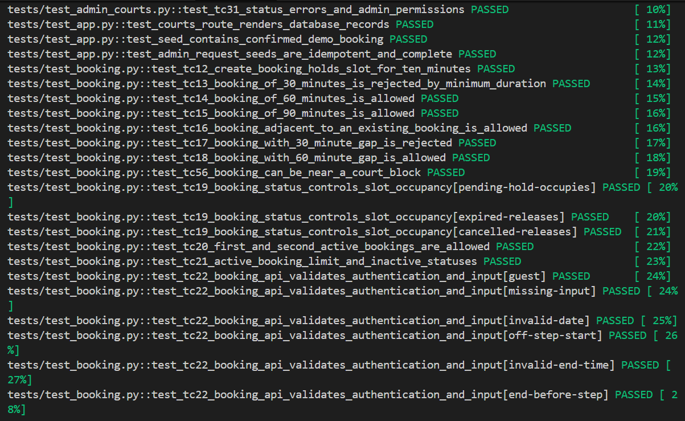
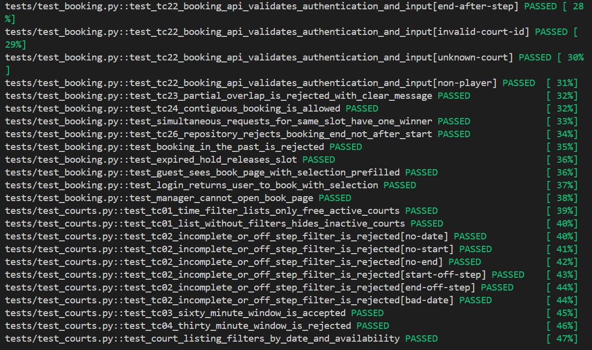
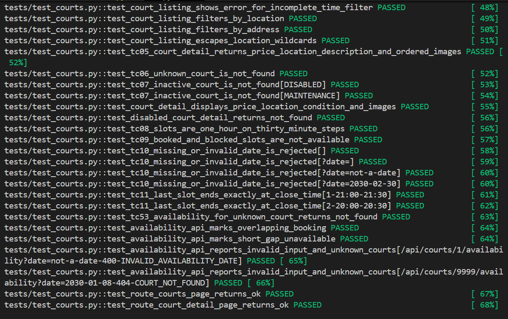
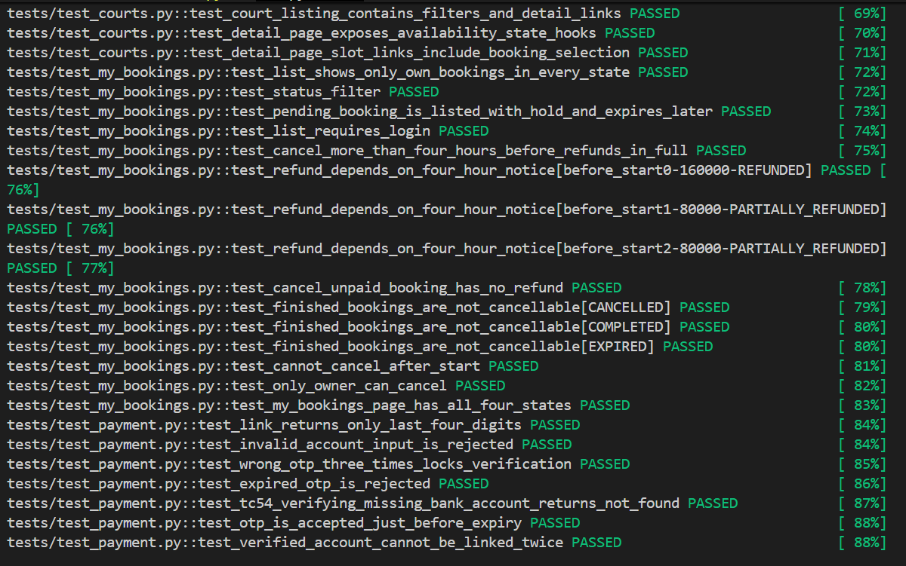
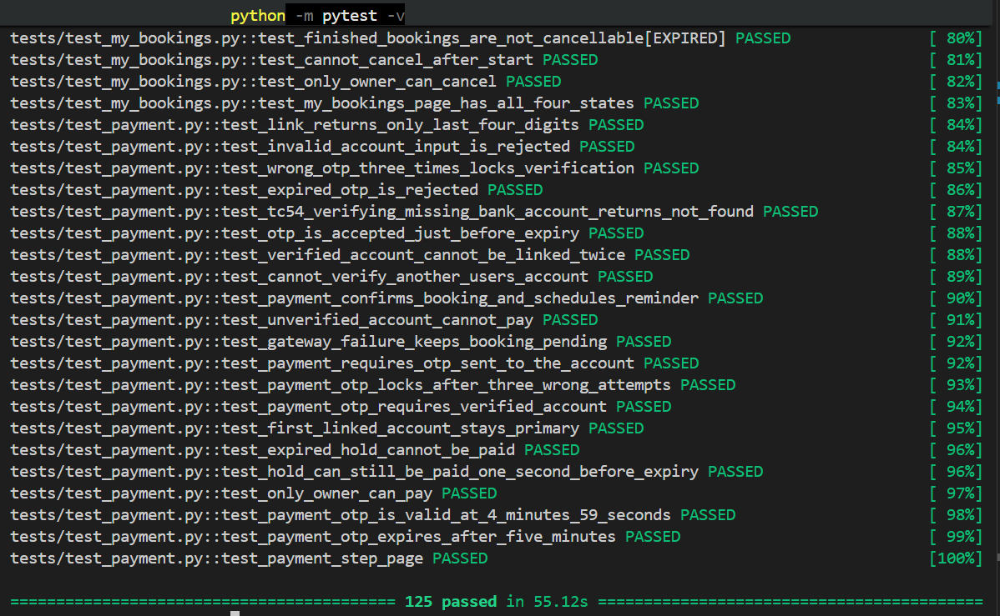

# Milestone 4 - Testing Document

**Team:** Team 01 - SmashGo

**Topic:** D2 - Sports Platform

**Members:**

- Chử Vũ Thảo Hiền (ID: 11247287)
- Phan Thị Anh Quỳnh (ID: 11247347)
- Bùi Phương Thảo (ID: 11247353)

**Product Owner:** @dqchien

**Scrum Master (Sprint 4):** @quynhquynh-blip

**Repository:** https://github.com/SE-FDA-NEU-AI66B/software-group1-topicd2

**Project board:** https://github.com/orgs/SE-FDA-NEU-AI66B/projects/24

**Setup guide:** https://github.com/SE-FDA-NEU-AI66B/software-group1-topicd2/blob/main/docs/SETUP.md

**Submitted by:** Chử Vũ Thảo Hiền

---

**Project board right after Sprint 4 Planning:**


**Project board on the submission day:**


---

## 1. What we test, and why

| Layer           | Test                                           | Why                                                                                                              |
| --------------- | ---------------------------------------------- | ---------------------------------------------------------------------------------------------------------------- |
| services        | Booking, availability, admin and payment rules | Tests cover booking constraints, holds, review decisions, payment and OTP behavior.                              |
| repository (db) | SQLite schema, constraints and transactions    | Fresh temporary databases isolate tests; database constraints and concurrent booking transactions are exercised. |
| routes          | Flask API and page routes                      | The test client checks response bodies, status codes, authorization and validation errors.                       |
| interface (UI)  | Server-rendered pages and navigation           | Tests check important page content, states and links without a live server.                                      |

Coverage focuses on booking and payment rules, where timing, concurrency and authorization affect whether a user can secure a court or complete a payment. Admin request/status APIs and database transaction behavior are also tested; payment gateway calls are replaced by a fake. UI checks cover rendered content and links, not real-browser interaction.

## 2. Test cases for every P0 story

Kind values: normal, error, boundary (just below), boundary (on the limit), boundary (just above).

### US-01 - View Available Badminton Courts

Reserved IDs: TC-01 to TC-04. Needs at least 3 cases: 1 normal, 1 error; if the rule has a number, boundary cases on both sides.

| ID    | Story | Input                                                                                                                               | Expected                                                                   | Kind                    |
| ----- | ----- | ----------------------------------------------------------------------------------------------------------------------------------- | -------------------------------------------------------------------------- | ----------------------- |
| TC-01 | US-01 | `GET /api/courts?date=<tomorrow>&startTime=20:00&endTime=21:00`; court A booked 20:00-22:00, one DISABLED and one MAINTENANCE court | 200, only court B listed; booked, DISABLED and MAINTENANCE courts left out | normal                  |
| TC-02 | US-01 | Filter missing `date`, `startTime` or `endTime`; time not on a 30-minute step (19:15, 20:10); invalid date                          | 400 `INVALID_COURT_FILTER`                                                 | error                   |
| TC-03 | US-01 | Filter window 19:00-20:00 (60 minutes)                                                                                              | 200, both free courts listed                                               | boundary (on the limit) |
| TC-04 | US-01 | Filter window 19:00-19:30 (30 minutes)                                                                                              | 400 `INVALID_COURT_FILTER`                                                 | boundary (just below)   |

Rules: none. Codes: 400 INVALID_COURT_FILTER

### US-02 - View Detailed Court Information

Reserved IDs: TC-05 to TC-07. Needs at least 3 cases: 1 normal, 1 error; if the rule has a number, boundary cases on both sides.

| ID    | Story | Input                                                                  | Expected                                                                                         | Kind   |
| ----- | ----- | ---------------------------------------------------------------------- | ------------------------------------------------------------------------------------------------ | ------ |
| TC-05 | US-02 | `GET /api/courts/1` (ACTIVE court with two images stored out of order) | 200 with price 100000, address, description, opening hours, images ordered by `sortOrder` (0, 1) | normal |
| TC-06 | US-02 | `GET /api/courts/9999`                                                 | 404 `COURT_NOT_FOUND`                                                                            | error  |
| TC-07 | US-02 | `GET /api/courts/1` after court 1 is set to DISABLED or MAINTENANCE    | 404 `COURT_NOT_FOUND`                                                                            | error  |

Rules: none. Codes: 404 COURT_NOT_FOUND

### US-03 - View Available Time Slots

Reserved IDs: TC-08 to TC-11 and TC-53. Needs at least 3 cases: 1 normal, 1 error; if the rule has a number, boundary cases on both sides.

| ID    | Story | Input                                                                            | Expected                                                                                                                                                                                                                                                | Kind                                 |
| ----- | ----- | -------------------------------------------------------------------------------- | ------------------------------------------------------------------------------------------------------------------------------------------------------------------------------------------------------------------------------------------------------- | ------------------------------------ |
| TC-08 | US-03 | `GET /api/courts/1/availability?date=<tomorrow>` (open 06:00-22:00, no bookings) | 200; first slot 06:00; every slot lasts 60 minutes; slots start 30 minutes apart; all `AVAILABLE`                                                                                                                                                       | normal                               |
| TC-09 | US-03 | Same request with a booking 20:00-22:00 and a `Court_Block` 10:00-12:00          | `BOOKED`, `available: false`: starts 09:30, 10:00, 10:30, 11:00, 11:30 (block), 19:30, 20:00, 20:30, 21:00 (booking); `AVAILABLE`: 12:00, 12:30 (block does not trigger BR2), 19:00 (back-to-back); `UNAVAILABLE`: 18:30 (30-minute gap before booking) | normal                               |
| TC-10 | US-03 | `date` missing, empty, `not-a-date` or `2030-02-30`                              | 400 `INVALID_AVAILABILITY_DATE`                                                                                                                                                                                                                         | error                                |
| TC-11 | US-03 | Court A closes 22:00, court B closes 21:00                                       | Last slot ends exactly at CloseTime (21:00-22:00, 20:00-21:00) is offered; a slot starting 30 minutes later (21:30, 20:30) is not                                                                                                                       | boundary (on the limit / just above) |
| TC-53 | US-03 | `GET /api/courts/9999/availability?date=<tomorrow>`                              | 404 `COURT_NOT_FOUND`                                                                                                                                                                                                                                   | error                                |

Rules: BR2. Codes: 400 INVALID_AVAILABILITY_DATE; 404 COURT_NOT_FOUND

### US-04 - Book One Available Time Slot

Reserved IDs: TC-12 to TC-22, TC-51 to TC-52, and TC-56. Needs at least 3 cases: 1 normal, 1 error; if the rule has a number, boundary cases on both sides.

| ID    | Story | Input                                                                                                                                                                  | Expected                                                                                                        | Kind                    |
| ----- | ----- | ---------------------------------------------------------------------------------------------------------------------------------------------------------------------- | --------------------------------------------------------------------------------------------------------------- | ----------------------- |
| TC-12 | US-04 | `POST /api/bookings` for an available court and slot                                                                                                                   | 201, status `PENDING`, `HoldExpiresAt` is 10 minutes after the fixed clock                                      | normal                  |
| TC-13 | US-04 | Start 08:00, end 08:30 (30 minutes)                                                                                                                                    | 422 `BOOKING_RULE_VIOLATION`                                                                                    | boundary (just below)   |
| TC-14 | US-04 | Start 08:00, end 09:00 (60 minutes)                                                                                                                                    | 201                                                                                                             | boundary (on the limit) |
| TC-15 | US-04 | Start 08:00, end 09:30 (90 minutes)                                                                                                                                    | 201                                                                                                             | boundary (just above)   |
| TC-16 | US-04 | Existing booking 20:00-21:00; request 19:00-20:00 (0-minute gap)                                                                                                       | 201                                                                                                             | boundary (on the limit) |
| TC-17 | US-04 | Existing booking 20:00-21:00; request 18:30-19:30 (30-minute gap)                                                                                                      | 422 `BOOKING_RULE_VIOLATION`                                                                                    | boundary (just below)   |
| TC-18 | US-04 | Existing booking 20:00-21:00; request 18:00-19:00 (60-minute gap)                                                                                                      | 201                                                                                                             | boundary (on the limit) |
| TC-19 | US-04 | Request an occupied slot held by unexpired `PENDING`, `EXPIRED`, or `CANCELLED` booking                                                                                | Pending hold: 409 `SLOT_UNAVAILABLE`; expired/cancelled: 201                                                    | normal / error          |
| TC-20 | US-04 | User's first and second active bookings                                                                                                                                | Both return 201                                                                                                 | normal                  |
| TC-21 | US-04 | User already has 2 active bookings, then tries a third; mark previous bookings `CANCELLED` and `EXPIRED` and retry                                                     | Third active booking: 409 `ACTIVE_BOOKING_LIMIT`; inactive bookings do not count and retry returns 201          | error / normal          |
| TC-22 | US-04 | Guest request; missing fields; malformed date/time/court ID; start off 30-minute step; end time off 30-minute step (e.g. 08:59, 09:01); unknown court; non-player role | 401 `UNAUTHENTICATED`; 400 `INVALID_INPUT` for malformed/off-step input; 404 `COURT_NOT_FOUND`; 403 `FORBIDDEN` | error                   |
| TC-51 | US-04 | Court closes at 23:00; existing booking 20:00-21:00; request 21:30-22:30 (30-minute gap)                                                                               | 422 `BOOKING_RULE_VIOLATION`                                                                                    | boundary (just below)   |
| TC-52 | US-04 | Court closes at 23:00; existing booking 20:00-21:00; request 22:00-23:00 (60-minute gap)                                                                               | 201                                                                                                             | boundary (on the limit) |
| TC-56 | US-04 | `Court_Block` 10:00-12:00; request 08:00-09:30 (30-minute gap before) and 12:30-13:30 (30-minute gap after)                                                            | Both bookings return 201; BR2 does not apply to a block                                                         | boundary (just above)   |

Rules: BR1, BR2, BR3, BR6. Codes: 400 INVALID_INPUT; 401 UNAUTHENTICATED; 403 FORBIDDEN; 404 COURT_NOT_FOUND; 409 SLOT_UNAVAILABLE, ACTIVE_BOOKING_LIMIT; 422 BOOKING_RULE_VIOLATION

### US-05 - Prevent Double Booking

Reserved IDs: TC-23 to TC-26. Needs at least 3 cases: 1 normal, 1 error; if the rule has a number, boundary cases on both sides.

| ID    | Story | Input                                                                                                  | Expected                                                       | Kind           |
| ----- | ----- | ------------------------------------------------------------------------------------------------------ | -------------------------------------------------------------- | -------------- |
| TC-23 | US-05 | Existing booking 20:00-22:00; request 19:30-20:30 (partial overlap)                                    | 409 `SLOT_UNAVAILABLE`                                         | error          |
| TC-24 | US-05 | Existing booking 20:00-22:00; request 19:00-20:00 (adjacent, no overlap)                               | 201                                                            | normal         |
| TC-25 | US-05 | Two concurrent requests from separate connections for the same court and slot, using `BEGIN IMMEDIATE` | Exactly one succeeds; the other returns `409 SLOT_UNAVAILABLE` | normal / error |
| TC-26 | US-05 | Repository insert with `EndTime <= StartTime`                                                          | SQLite `CHECK` constraint raises `IntegrityError`              | error          |

Rules: BR1. Codes: 409 SLOT_UNAVAILABLE

### US-11 - Activate or Deactivate Badminton Courts

Reserved IDs: TC-27 to TC-31. Needs at least 3 cases: 1 normal, 1 error; if the rule has a number, boundary cases on both sides.

| ID    | Story | Input                                                                                  | Expected                                                                                                                           | Kind     |
| ----- | ----- | -------------------------------------------------------------------------------------- | ---------------------------------------------------------------------------------------------------------------------------------- | -------- |
| TC-27 | US-11 | Admin disables court B, a User tries to book it, then Admin reactivates it             | 200 DISABLED; hidden from `/courts`; booking returns 404 `COURT_NOT_FOUND`; reactivation returns 200 ACTIVE and it is listed again | normal   |
| TC-28 | US-11 | Disable court A with a future `CONFIRMED` booking                                      | 409 `COURT_HAS_UPCOMING_BOOKINGS`; status remains ACTIVE and Admin list reports one upcoming booking                               | error    |
| TC-29 | US-11 | Disable court with future `CANCELLED`/`EXPIRED` bookings or a past `CONFIRMED` booking | 200 DISABLED for each case                                                                                                         | boundary |
| TC-30 | US-11 | Disable courts with a future `PENDING` booking whose hold is unexpired / expired       | Unexpired hold: 409 `COURT_HAS_UPCOMING_BOOKINGS`; expired hold: 200 DISABLED                                                      | boundary |
| TC-31 | US-11 | PATCH with invalid status, unknown court, guest, User or Manager                       | 400 `INVALID_STATUS`; 404 `COURT_NOT_FOUND`; 401 `UNAUTHENTICATED`; 403 `ADMIN_REQUIRED`                                           | error    |

Rules: none. Codes: 400 INVALID_STATUS; 401 UNAUTHENTICATED; 403 ADMIN_REQUIRED; 404 COURT_NOT_FOUND; 409 COURT_HAS_UPCOMING_BOOKINGS

### US-12 - Approve or Reject Court Request

Reserved IDs: TC-32 to TC-36. Needs at least 3 cases: 1 normal, 1 error; if the rule has a number, boundary cases on both sides.

| ID    | Story | Input                                                                      | Expected                                                                                                    | Kind           |
| ----- | ----- | -------------------------------------------------------------------------- | ----------------------------------------------------------------------------------------------------------- | -------------- |
| TC-32 | US-12 | Approve a pending request with two images                                  | 200 APPROVED; creates ACTIVE court owned by request Manager and copies both images                          | normal         |
| TC-33 | US-12 | Reject without reason, then reject with a reason                           | Missing reason: 400 `INVALID_DECISION`; reasoned rejection: status REJECTED, no court created               | error / normal |
| TC-34 | US-12 | Approve a request, then review it again                                    | Second review returns 409 `REQUEST_ALREADY_REVIEWED`; no duplicate court is created                         | error          |
| TC-35 | US-12 | Invalid decision, missing request, or guest/User/Manager reviewing         | 400 `INVALID_DECISION`; 404 `REQUEST_NOT_FOUND`; 401 `UNAUTHENTICATED`; 403 `ADMIN_REQUIRED`                | error          |
| TC-36 | US-12 | GET requests by default, with `status=ALL`, and with an unsupported status | Default returns PENDING only; `ALL` returns prior decisions; bad filter returns 400 `INVALID_STATUS_FILTER` | normal / error |

Rules: none. Codes: 400 INVALID_STATUS_FILTER, INVALID_DECISION; 401 UNAUTHENTICATED; 403 ADMIN_REQUIRED; 404 REQUEST_NOT_FOUND; 409 REQUEST_ALREADY_REVIEWED

### US-04 - Payment, Bank Linking and OTP (Task #111)

Reserved IDs: TC-37 to TC-50, TC-54 to TC-55.

The project has no scheduled background worker; expired holds are marked `EXPIRED` when booking operations or the booking-list endpoint run, which TC-40 verifies.

| ID    | Story | Input                                                                                                    | Expected                                                                                                                                                                   | Kind                  |
| ----- | ----- | -------------------------------------------------------------------------------------------------------- | -------------------------------------------------------------------------------------------------------------------------------------------------------------------------- | --------------------- |
| TC-37 | US-04 | Pay an unexpired booking using a verified account and correct OTP; then try to pay again                 | First payment confirms booking, creates one `SUCCESS` payment and a reminder scheduled 240 minutes before start; second payment returns 409 `HOLD_EXPIRED_OR_ALREADY_PAID` | normal / error        |
| TC-38 | US-04 | Pay 9 minutes 59 seconds after the booking hold starts                                                   | 200; booking becomes `CONFIRMED`                                                                                                                                           | boundary (just below) |
| TC-39 | US-04 | Pay 10 minutes and 1 second after the hold starts, then list bookings and retry the slot as another user | 409 `HOLD_EXPIRED_OR_ALREADY_PAID`; booking becomes `EXPIRED`; another user can book the released slot                                                                     | boundary (just above) |
| TC-40 | US-04 | List bookings after a pending hold expires while another booking is `CONFIRMED`                          | Pending booking becomes `EXPIRED`; confirmed booking stays `CONFIRMED`                                                                                                     | normal                |
| TC-41 | US-04 | Pay with a bank account that has not been verified                                                       | 422 `BANK_ACCOUNT_NOT_VERIFIED`; booking remains `PENDING`                                                                                                                 | error                 |
| TC-42 | US-04 | Submit payment OTP 4 minutes 59 seconds after issuance                                                   | 200; booking becomes `CONFIRMED`                                                                                                                                           | boundary (just below) |
| TC-43 | US-04 | Submit payment OTP 5 minutes 1 second after issuance                                                     | 409 `VERIFICATION_EXPIRED_OR_LOCKED`; booking remains `PENDING`                                                                                                            | boundary (just above) |
| TC-44 | US-04 | Submit two wrong payment OTPs, then the correct OTP                                                      | First two wrong attempts return 400 `INVALID_OTP`; correct OTP after two failures pays the booking                                                                         | error / normal        |
| TC-45 | US-04 | Submit three wrong payment OTPs, then the correct OTP to the locked verification                         | Attempts 1-2 return 400 `INVALID_OTP`; attempt 3 and subsequent attempts, including the correct OTP, return 409 `VERIFICATION_EXPIRED_OR_LOCKED`                           | error                 |
| TC-46 | US-04 | Pay without login; pay another user's booking; request a missing booking                                 | 401 `UNAUTHENTICATED`; 403 `NOT_BOOKING_OWNER`; 404 `BOOKING_NOT_FOUND`                                                                                                    | error                 |
| TC-47 | US-04 | Link a bank account and inspect link/list responses                                                      | Only the last four account digits are returned; full account number, OTP and OTP hash are not exposed                                                                      | normal                |
| TC-48 | US-04 | Link an already verified bank account again                                                              | 409 `BANK_ACCOUNT_EXISTS`                                                                                                                                                  | error                 |
| TC-49 | US-04 | Verify the first linked account, then link and verify another account                                    | The first verified account remains the only primary account                                                                                                                | normal                |
| TC-50 | US-04 | Payment gateway returns a failed charge                                                                  | 502 `PAYMENT_FAILED`; booking remains `PENDING` and no payment row is created                                                                                              | error                 |
| TC-54 | US-04 | Verify bank account ID 9999, which does not exist                                                        | 404 `BANK_ACCOUNT_NOT_FOUND`                                                                                                                                               | error                 |
| TC-55 | US-04 | Verify a bank account belonging to another user                                                          | 403 `NOT_ACCOUNT_OWNER`                                                                                                                                                    | error                 |

Rules: BR3, BR5, BR7. Codes: 400 INVALID_INPUT, INVALID_OTP; 401 UNAUTHENTICATED; 403 NOT_BOOKING_OWNER, NOT_ACCOUNT_OWNER; 404 BOOKING_NOT_FOUND, BANK_ACCOUNT_NOT_FOUND; 409 HOLD_EXPIRED_OR_ALREADY_PAID, VERIFICATION_EXPIRED_OR_LOCKED, BANK_ACCOUNT_EXISTS; 422 BANK_ACCOUNT_NOT_VERIFIED; 502 PAYMENT_FAILED

## 3. Automated tests

Command: `python -m pytest -v`

- **No server, no real database:** tests call the Flask app through its test client. The `database_path` fixture in `tests/conftest.py` builds a fresh SQLite file in pytest's `tmp_path` from `schema.sql` for every test and seeds a minimal data set (2 Users, 1 Manager, 1 Admin, 2 ACTIVE courts with opening hours, 1 verified bank account). Nothing reads `instance/`, `.env` or a database dump; only `tests/test_app.py` runs `init_db.py`, because it tests the demo seed itself.
- **Fixed clock:** application code reads the time through `clock.now()` / `clock.today()`. The autouse `frozen_clock` fixture pins it to Monday 2030-01-07 09:00, and tests move it with `frozen_clock.advance(...)` (for example to expire the 10-minute hold, BR3), so results never depend on the day the suite runs.
- **Fake bank gateway:** the autouse `fake_gateway` fixture replaces `bank_gateway.send_otp` and `charge`: the OTP is always `123456`, no outside service is called, every OTP and charge is recorded, and `fake_gateway.fail_charges = True` simulates `PAYMENT_FAILED`.
- **Test case IDs:** a test that implements a case in section 2 carries the ID in a comment directly above it, for example `# TC-08: ...`, so `grep TC-08 tests/` finds it.
- **Where:** all tests live in `tests/`; shared constants and helpers are in `tests/support.py`. Run `pytest` (or `python -m pytest -v`) from the repository root; `pytest.ini` sets `testpaths = tests`. Test dependencies: `pip install -r requirements-dev.txt`.








## 4. What the tests found

- Rule broken on purpose: temporarily removed the upcoming-booking guard from court deactivation and the rejection-reason validation.
- Red test output captured from `python -m pytest -q -rx tests/test_admin_courts.py -k "tc28 or tc33"`:

  ```text
  FF                                                                       [100%]
  > assert missing_reason.status_code == 400
  E       assert 200 == 400
  > assert response.status_code == 409
  E       assert 200 == 409
  2 failed, 11 deselected in 2.40s
  ```

  TC-33 received 200 instead of 400 without a rejection reason; TC-28 received 200 instead of 409 with a confirmed future booking.

- Additional findings from specification tests: the booking parser accepted end times off the 30-minute step (09:01 returned 201; 08:59 returned 422 instead of 400); `booking_service.py` now rejects both as `400 INVALID_INPUT`. Availability applied BR2 to `Court_Block` (the 12:30 slot after a 10:00-12:00 block was incorrectly `UNAVAILABLE`); `court_service.py` now applies BR2 gaps only between bookings, and booking creation uses the same rule.
- Design discrepancies: the booking endpoint omitted `403 FORBIDDEN`, and the BR2 scope did not explicitly exclude `Court_Block`; both are now documented in `docs/design.md`.
- Fix: both temporarily removed Admin guards were restored; the TC-28/TC-33 command now passes.
- Guarding tests: TC-28 and TC-30 cover upcoming bookings and pending holds; TC-33 covers the rejection reason.
