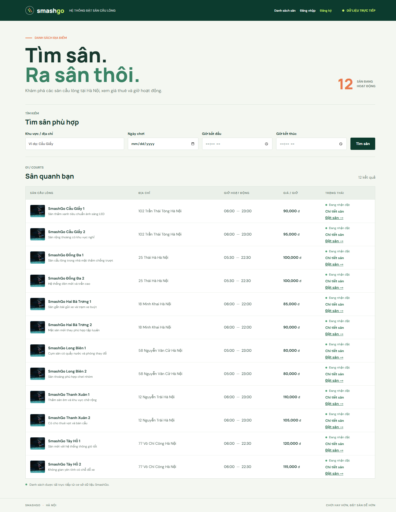
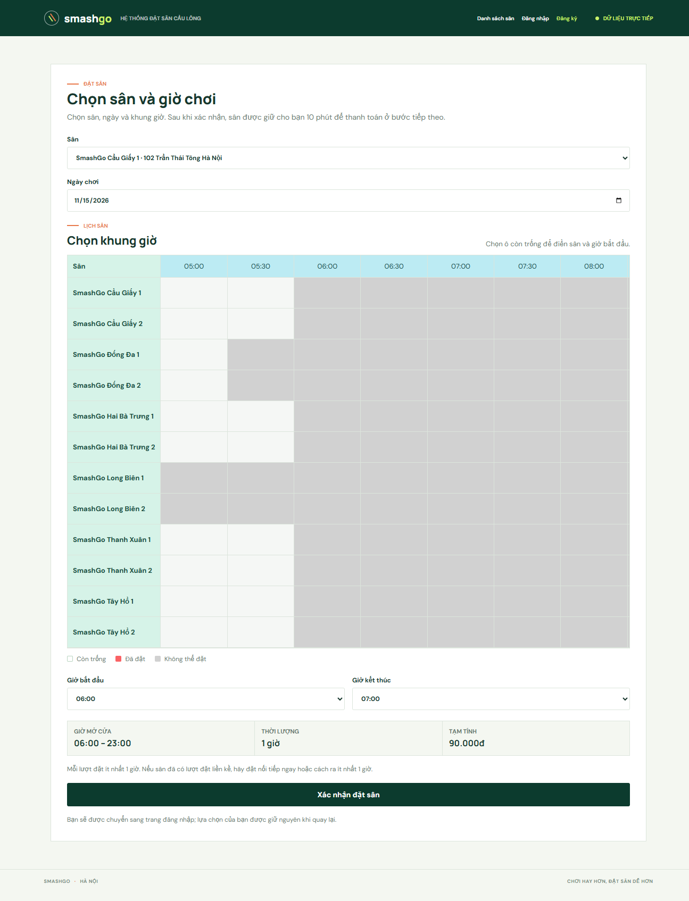
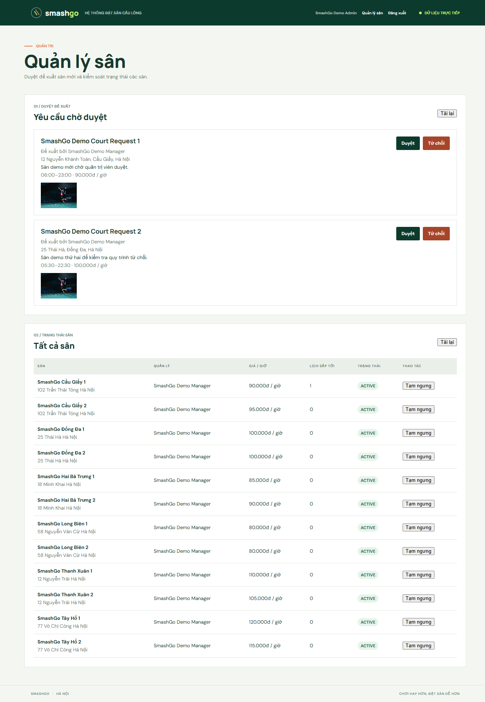
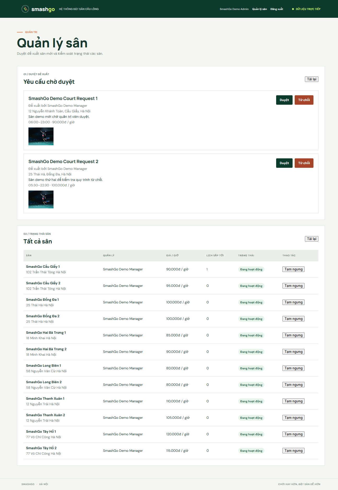
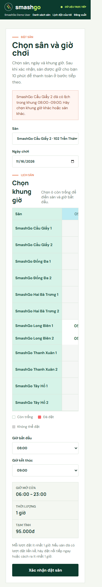

# Milestone 3 - UI Document

**Team:** Team 01 - SmashGo

**Topic:** D2 - Sports Platform

**Members:**

- Chử Vũ Thảo Hiền (ID: 11247287)
- Phan Thị Anh Quỳnh (ID: 11247347)
- Bùi Phương Thảo (ID: 11247353)

**Product Owner:** @dqchien

**Scrum Master:** @dqchien (Sprint 3)

**Repository:** https://github.com/SE-FDA-NEU-AI66B/software-group1-topicd2

**Project board:** https://github.com/orgs/SE-FDA-NEU-AI66B/projects/24

**Setup guide:** https://github.com/SE-FDA-NEU-AI66B/software-group1-topicd2/blob/main/docs/SETUP.md

**Submitted by:** Chử Vũ Thảo Hiền

---

**Project board right after Sprint 2 Planning:**


**Project board on the submission day:**


---

**P0 screen with real data**


**Error message shown to the user**


---

# UI Screens and Flows

This document maps user stories to the screens and routes currently implemented
in the application. P0 screens have a wireframe in `docs/images/ui/`.

## 1. P0 stories and status

The M1 backlog marks US-01 to US-05 and US-11 to US-12 as P0. Status values
use the required `works`, `partly works`, or `not started` labels.

| Story                                   | Screen(s)                                            | Route                                                                                             | Status | Issue                                                   |
| --------------------------------------- | ---------------------------------------------------- | ------------------------------------------------------------------------------------------------- | ------ | ------------------------------------------------------- |
| US-01 — View available courts           | Court list and filters                               | `GET /courts` (`/` redirects here)                                                                | works  | #95 — court discovery and availability                  |
| US-02 — View court details              | Booking (court information card)                     | `GET /book?courtId={courtId}`                                                                     | works  | #95 — court discovery and availability                  |
| US-03 — View available time slots       | Booking (court schedule)                             | `GET /book`                                                                                       | works  | #95 — court discovery and availability                  |
| US-04 — Book one available time slot    | Booking; login or registration; payment; my bookings | `GET /book`; `GET /login`; `GET /register`; `GET /book?bookingId={bookingId}`; `GET /my-bookings` | works  | #91 — booking hold; #92 — payment; #96 — authentication |
| US-05 — Prevent double booking          | Booking                                              | `GET /book`                                                                                       | works  | #91 — booking hold                                      |
| US-11 — Activate or deactivate courts   | Admin court management                               | `GET /admin/courts`                                                                               | works  | #94 — Admin court management                            |
| US-12 — Approve or reject court request | Admin court management                               | `GET /admin/courts`                                                                               | works  | #94 — Admin court management                            |

### Updated screen flow from M1

### Guest and User booking flow

```text
GET / or /courts
  -> search courts by area (district or street; accents and capitals ignored)
  -> "Đặt sân →" on a court: GET /book?courtId=...
       -> court information card: photos, address, description, price, hours
       -> GET /api/courts/{courtId}/availability?date=... for the schedule
  -> choose an available slot
       -> if Guest: GET/POST /login or GET/POST /register, then return to /book
  -> POST /api/bookings
       -> create a 10-minute PENDING hold
  -> GET /book?bookingId={bookingId}
       -> step 1, account: the saved (primary) account is selected by default;
          a first-time User, or "+ Thêm tài khoản", types a new account
          (saved account: POST /api/bookings/{bookingId}/payment/otp;
           new account: POST /api/bank-accounts, which sends the OTP)
       -> step 2, OTP: enter the OTP the bank sent
       -> step 3, confirm: review court, time, account and amount, then
          POST /api/bookings/{bookingId}/payment
          (a new account is verified and saved by this same OTP)
  -> GET /my-bookings
```

An authenticated User skips sign-in and registration. `/` is a redirect to
`/courts`, not a separate screen. The M1 `/availability` screen is replaced by
the area search on `/courts` and the schedule on `/book`; `/availability` is
not a current application route. The court detail page `/courts/{courtId}`
was merged into `/book` (section 7); its old links redirect there.

### Admin flow

```text
GET/POST /login
  -> role = ADMIN
  -> GET /admin/courts
       -> GET /api/admin/court-requests
       -> POST /api/admin/court-requests/{requestId}/review
       -> GET /api/admin/courts
       -> PATCH /api/admin/courts/{courtId}/status
```

### Manager flow

```text
GET/POST /login
  -> role = MANAGER
  -> GET /manager/courts
       -> P1 route; the page is currently an unsupported-feature placeholder
```

## 2. Wireframes

| Screen(s)                                | “The user comes here to …”                                                         | API endpoints                                                                                                                                                                                 | Wireframe                                                              |
| ---------------------------------------- | ---------------------------------------------------------------------------------- | --------------------------------------------------------------------------------------------------------------------------------------------------------------------------------------------- | ---------------------------------------------------------------------- |
| Court list, details, and availability    | find courts, review court details, and choose an available time slot.              | `GET /api/courts`; `GET /api/courts/{courtId}`; `GET /api/courts/{courtId}/availability?date=...`                                                                                             | [images/ui/courts-availability.svg](images/ui/courts-availability.svg) |
| Booking and hold creation                | choose a court, date, and time, then create a temporary booking hold.              | `POST /api/bookings`                                                                                                                                                                          | [images/ui/book.svg](images/ui/book.svg)                               |
| Login and registration                   | sign in or create a User account and return to the requested booking screen.       | No JSON API; form submissions: `POST /login`, `POST /register`                                                                                                                                | [images/ui/auth.svg](images/ui/auth.svg)                               |
| Payment, bank account, and OTP           | link and verify a bank account, request a payment OTP, and pay for a held booking. | `GET /api/bank-accounts`; `POST /api/bank-accounts`; `POST /api/bank-accounts/{bankAccountId}/verify`; `POST /api/bookings/{bookingId}/payment/otp`; `POST /api/bookings/{bookingId}/payment` | [images/ui/payment.svg](images/ui/payment.svg)                         |
| My bookings                              | view booking status and details, and manage eligible bookings.                     | `GET /api/bookings/mine`; `DELETE /api/bookings/{bookingId}` (P1 cancellation)                                                                                                                | [images/ui/my-bookings.svg](images/ui/my-bookings.svg)                 |
| Admin court review and status management | review new court requests and activate or deactivate courts.                       | `GET /api/admin/court-requests`; `POST /api/admin/court-requests/{requestId}/review`; `GET /api/admin/courts`; `PATCH /api/admin/courts/{courtId}/status`                                     | [images/ui/admin-courts.svg](images/ui/admin-courts.svg)               |

## 3. Error messages

API errors use the response shape `{ "code": "...", "message": "..." }`. The
screen presenting an actionable error should preserve the form values and show
the message as an alert. These M2 messages are the required user-facing copy:

| HTTP status | Code                           | Rule | Message                                                                                                          |
| ----------- | ------------------------------ | ---- | ---------------------------------------------------------------------------------------------------------------- |
| 409         | `SLOT_UNAVAILABLE`             | BR1  | “This court was just booked for that time. Please choose another time or court.”                                 |
| 409         | `ACTIVE_BOOKING_LIMIT`         | BR6  | “You already have 2 active bookings. Complete or cancel one before booking another.”                             |
| 422         | `BOOKING_RULE_VIOLATION`       | BR2  | “A booking must last at least 1 hour; bookings on the same court must be back-to-back or at least 1 hour apart.” |
| 422         | `BANK_ACCOUNT_NOT_VERIFIED`    | BR7  | “Your bank account is not verified yet. Enter the OTP to verify it before paying.”                               |
| 409         | `HOLD_EXPIRED_OR_ALREADY_PAID` | BR3  | “The 10-minute hold has ended and the slot was released. Please book again.”                                     |

`SLOT_UNAVAILABLE`, `ACTIVE_BOOKING_LIMIT`, and `BOOKING_RULE_VIOLATION` are
returned by `POST /api/bookings`. `BANK_ACCOUNT_NOT_VERIFIED` and
`HOLD_EXPIRED_OR_ALREADY_PAID` are returned by
`POST /api/bookings/{bookingId}/payment`.
When the 10-minute payment hold expires, the booking status is `EXPIRED` and
the slot is released.

## 4. What changed since M2

M2 documented the architecture and API contracts. Since then, the repository
has added the corresponding user-facing routes, screens, API handlers, and
automated tests:

### Change 1: Designed court discovery and booking flows are implemented

- **What changed:** Court search, court details and availability now lead into
  sign-in or registration when needed, a 10-minute booking hold, and payment.
  Booking creation checks overlapping bookings within a serialized
  `BEGIN IMMEDIATE` transaction.
- **Evidence:** `routes/courts.py`, `routes/auth.py`, `routes/bookings.py`,
  `booking_service.py`, and `tests/test_courts.py` / `tests/test_booking.py`.
- **Effect on this document:** The current routes and their implemented status
  are listed above. `/availability` is not a standalone route; filters are on
  `/courts` and availability is shown on `/courts/{courtId}`.

### Change 2: Payment now requests a separate OTP for each payment

- **What changed:** In addition to verifying a linked bank account, the
  payment flow sends a payment OTP to the selected verified account before
  charging it. The first linked account is marked primary and selected by
  default. The payment OTP expires after five minutes and is limited to three
  attempts.
- **Evidence:** `POST /api/bookings/{bookingId}/payment/otp` in
  `routes/bookings.py`; OTP and primary-account handling in `payment_service.py`
  and `static/payment.js`; coverage in `tests/test_payment.py`.
- **Effect on this document:** The payment flow includes requesting and entering
  a payment OTP before `POST /api/bookings/{bookingId}/payment`. Only the
  account's last four digits are displayed.

### Change 3: Booking management and Admin screens are implemented

- **What changed:** Users can view their bookings and cancel eligible bookings;
  Admins can review court requests and activate or deactivate courts. The
  Manager court workspace is still an unsupported-feature placeholder and is
  not implemented.
- **Evidence:** `routes/bookings.py` and `booking_service.py`;
  `routes/admin.py` and `admin_service.py`; corresponding tests in
  `tests/test_my_bookings.py` and `tests/test_admin_courts.py`.
- **Effect on this document:** `/my-bookings` and `/admin/courts` are marked
  Implemented in the table above; `/manager/courts` remains Placeholder.

## 5. M3 feedback addressed in Task #128

### Price formatting

Court list and detail prices now use the same Vietnamese thousands separator as
the booking summary and payment screens. The court-list screenshots show the
change from a comma to a period. The booking summary already used a period, so
it is included only as a reference.

| Before | After |
| ------ | ----- |
|  |  |



### Admin court statuses

The Admin screen now shows Vietnamese status labels while preserving the
server's status values for API requests and CSS state styling.

| Before | After |
| ------ | ----- |
|  |  |

### Double-booking rejection and mobile check

For US-05, the server rejects an occupied slot with HTTP 409 and a message that
names the court and occupied time, then recommends choosing another time or
court. The booking screen displays that message in its alert region. The P0
screens were also checked at a 375px viewport.



## 6. Payment split into steps

- **What changed:** The payment page used to show the account list, the
  link form, the link OTP, the Pay button and the payment OTP together. It now
  shows one step at a time, in the order of a bank transfer: (1) account,
  (2) OTP, (3) confirm. A User who has a saved account gets it selected by
  default and does not type it again; "+ Thêm tài khoản" opens the form for
  another account. A first-time User types the account once and enters one
  OTP: that OTP verifies and saves the account and authorises the payment.
  A wrong or expired OTP returns to step 2; a declined charge returns to
  step 1 with the account already saved.
- **Evidence:** `templates/pages/payment.html`, `static/payment.js`,
  `static/css/book.css`; `_payment_account` in `payment_service.py`;
  `tests/test_payment.py`: `test_new_account_pays_with_the_link_otp_and_is_saved`,
  `test_new_account_wrong_otp_is_not_saved`,
  `test_new_account_is_saved_even_when_the_bank_declines`,
  `test_payment_step_page`.
- **Effect on this document:** the US-04 flow in section 2 lists the three
  steps.

## 7. Larger text, area search and the court detail page merged into booking

- **What changed:**
  - Text is larger across the site: no text is below 13px, and body text is
    14–16px. On phones (375px) no page scrolls sideways: the court list and
    the Admin court table become one card per court, and the menu wraps
    onto its own line.
  - The court list searches by area only; the date field was removed because
    the date is chosen on `/book`. The search matches the court's address
    (not its name), ignores accents and capitals ("cau giay" finds
    "Cầu Giấy") and matches from the start of a word. The seed addresses now
    include the district (for example "102 Trần Thái Tông, Cầu Giấy, Hà Nội").
  - The court detail page is removed: its slot picker repeated the booking
    page. Its information (photos, address, description, price, hours) is a
    card on `/book` that follows the selected court. `/courts/{courtId}`
    redirects to `/book?courtId={courtId}`.
- **Evidence:** `court_service.py` (`normalize_place`, `location_matches`),
  `data/courts.csv`, `init_db.py`, `routes/courts.py`, `routes/bookings.py`,
  `templates/courts.html`, `templates/pages/book.html`, `static/book.js`,
  the stylesheets in `static/`; `tests/test_courts.py`.
- **Effect on this document:** US-02, US-03 and US-05 point to `/book` in
  section 1, and the booking flow in section 2 starts from the area search.
